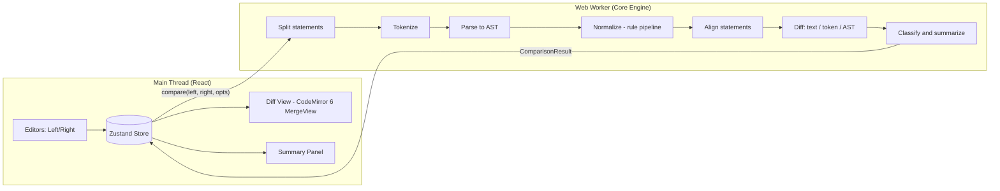

# SQL Compare — Project Plan

A client-side web app for comparing two SQL files or snippets. It formats and normalizes both inputs, then shows the differences side by side. It labels every difference in one of three separate categories:

- **Formatting**: whitespace, indentation, line breaks, comments, keyword case. No effect on the query.
- **Structural**: the SQL is written or arranged differently, but the meaning is provably the same under the active normalization rules. Examples: `AND` operand order, `INNER JOIN` vs `JOIN`, redundant quotes.
- **Potential semantic**: the change may alter results or behavior. Examples: columns, tables, joins, predicates, literals, ordering.

> **Decisions (v1):** PostgreSQL and MySQL first, other dialects later. CodeMirror 6 for the editor and diff. No shareable links in v1. Default normalization is L2, with L3 as an opt-in.

---

## 1. Goals & Scope

### 1.1 Goals
- Make it fast and easy to see what *actually* changed between two SQL queries or scripts.
- Keep cosmetic noise (whitespace, casing, indentation) apart from meaningful changes.
- Run everything locally in the browser. No SQL is executed, and nothing is uploaded by default.

### 1.2 In Scope (v1)
- Two input panes: paste SQL or upload `.sql` / `.txt` files (drag-and-drop supported).
- Dialect selection: **PostgreSQL** and **MySQL/MariaDB** are fully supported. A "Generic (ANSI)" mode does formatting and token diff only. Other dialects are added later through the parser-adapter interface, based on demand.
- Formatting (pretty-print) with configurable options.
- Normalization in configurable, **semantics-preserving** levels.
- Text diff, token-level diff, and AST diff. The results feed the three-way classification: formatting / structural / potential semantic.
- Side-by-side and inline diff views with synchronized scrolling and highlighting.
- A results summary that groups differences by category and severity.
- Multi-statement scripts, with statements aligned between the two files.
- Graceful handling of invalid or unsupported SQL, falling back to text/token diff.
- Export: copy normalized SQL, download a diff report (Markdown/HTML/JSON).

### 1.3 Out of Scope (v1)
- Executing SQL or connecting to any database.
- Schema-aware analysis (resolving `*`, type checking, catalog lookups).
- Query-plan or performance comparison.
- Full semantic equivalence proofs (e.g., algebraic rewrites of subqueries into joins).
- Accounts, server-side storage, or collaboration.

### 1.4 Future (v2+)
- Shareable links (state compressed into the URL hash, still client-only). **Explicitly deferred.** v1 focuses on paste, upload, formatting, and diff.
- Additional dialects: SQLite, SQL Server (T-SQL), BigQuery, Snowflake, in order of user demand.
- Three-way diff / merge.
- Optional schema upload (DDL) for column resolution.
- VS Code extension / CLI reusing the core engine.
- Batch directory comparison (migration folders).

---

## 2. Functional Requirements

| ID | Requirement |
|----|-------------|
| **FR-1 Input** | Two editors ("Left/Original", "Right/Modified") with SQL syntax highlighting, line numbers, and paste support. |
| FR-1.1 | Upload a file per side via button or drag-and-drop. Accept `.sql`, `.txt`, and `.ddl`, up to a 5 MB soft limit with a warning. Detect encoding (UTF-8, UTF-16 BOM). |
| FR-1.2 | Swap sides, clear, load sample, and auto-persist drafts to `localStorage` (opt-out). |
| **FR-2 Formatting** | "Format" action per side and for both. Options: keyword case, indent width, tabs/spaces, comma position, line width, and per-dialect formatting. |
| FR-2.1 | Formatting must never change tokens except whitespace and (optionally) keyword case. A post-format token check verifies this; if verification fails, the formatted output is discarded and a warning is shown. |
| **FR-3 Normalization** | Normalization levels, each toggleable and shown in the UI (see §5.4): L0 raw, L1 whitespace/comments, L2 lexical casing/quoting/synonyms (**default**), L3 aggressive safe structural reordering (**opt-in**, behind an "Aggressive normalization" toggle with an explanation). |
| FR-3.1 | The original SQL is always preserved. The user can switch between *Original*, *Formatted*, and *Normalized* views for each side. |
| FR-3.2 | Every normalization rule is listed in a "Transformations applied" panel, with a count and an example. |
| FR-3.3 | Rules that could change semantics are **never** applied automatically. Examples: reordering `ORDER BY` items, reordering `UNION` branches, reordering `LEFT JOIN`s, removing parentheses that affect precedence. |
| **FR-4 Difference detection** | Detect and classify differences in: statements, clauses (SELECT/FROM/WHERE/GROUP BY/HAVING/ORDER BY/LIMIT/WITH/window), select-list columns and aliases, tables and aliases, join type/order/conditions, predicates, literals/values, functions, subqueries/CTEs, DDL objects (columns, constraints, indexes), and DML targets/values. |
| FR-4.1 | Every difference gets exactly one classification:<br>• `formatting`: whitespace, comments, or keyword case only.<br>• `structural`: different shape or arrangement that the active normalization rules prove equivalent. Examples: synonym keywords, quoting, commutative reordering at L3.<br>• `semantic`: a potential change in meaning, such as columns, tables, join type/conditions, predicates, literals, ORDER BY/LIMIT, or DML/DDL targets.<br>• `unknown`: the statement could not be parsed, so the change is treated as potentially semantic.<br>A change the active level cannot prove equivalent is classified `semantic`. Example: `AND` reordering at L2. The UI shows a hint: "may be structural under aggressive normalization". |
| FR-4.2 | Every difference gets a severity: info / minor / major. For example, a changed `WHERE` predicate or join type is major. |
| **FR-5 Side-by-side view** | Two synchronized panes with aligned lines, inline character/token highlights, gutter markers, and collapsible unchanged regions. |
| FR-5.1 | Clicking a difference in the summary scrolls to it and highlights it on both sides. Hovering a token highlights its counterpart. |
| FR-5.2 | Toggle between side-by-side and inline (unified). Next/prev difference navigation (`F7`/`Shift+F7`, `n`/`p`). |
| FR-5.3 | Independent filter toggles for Formatting / Structural / Semantic. By default, formatting diffs are hidden from the highlight layer. |
| **FR-6 Results summary** | Header stats, such as "12 differences: 3 semantic · 2 structural · 7 formatting", plus a verdict: identical / formatting-only / structurally different but equivalent / potentially semantically different / unknown. |
| FR-6.1 | Structured list grouped by statement → clause, with human-readable descriptions (e.g., "JOIN `orders` changed from INNER to LEFT"). |
| FR-6.2 | Export the report as Markdown, HTML, or JSON. |
| **FR-7 Error handling** | Parse errors show line/column and a message inline. The comparison degrades to token/text diff for the affected statements, with a visible "Structural comparison unavailable" badge. |
| FR-7.1 | Unsupported syntax (vendor extensions, procedural blocks) is shown as an opaque node and compared textually. |

---

## 3. Non-Functional Requirements

| Category | Requirement |
|----------|-------------|
| **Privacy** | All processing is client-side. No network calls carry SQL. No analytics on content. Works offline (PWA). |
| **Performance** | < 200 ms to compare typical queries (< 500 lines). Up to 10k lines within 3 s, run in a Web Worker so the UI never blocks. Debounced live comparison (300 ms). |
| **Correctness** | Normalization is semantics-preserving by design and verified by tests (see §8). When in doubt, don't normalize. |
| **Responsiveness** | Desktop-first, but usable on tablet/mobile. Below 900px, panes stack vertically and a tab switcher appears. |
| **Accessibility** | WCAG 2.1 AA: keyboard navigation and visible focus. Diff meaning is never color-only (+/− icons, patterns, labels). Screen-reader labels for diff entries. Respects `prefers-reduced-motion`. |
| **Theming** | Dark (default) and light themes, plus a color-blind-safe diff palette option. |
| **Browser support** | Latest 2 versions of Chrome, Edge, Firefox, Safari. |
| **Bundle size** | Initial JS < 400 KB gzipped. Lazy-load the parser per dialect (PostgreSQL and MySQL only in v1). |
| **Maintainability** | TypeScript strict mode. The core engine is a framework-agnostic package with no DOM dependency. |
| **Security** | Never `innerHTML` user SQL without escaping. Strict CSP. No `eval`. |

---

## 4. UI/UX Design

### 4.1 Layout (desktop)

```
┌──────────────────────────────────────────────────────────────────────┐
│ ◆ SQL Compare [PostgreSQL|MySQL ▾] [Normalize: L2 ▾ ☐ Aggressive] [⚙] │
├──────────────────────────────────────────────────────────────────────┤
│ View: (Original | Formatted | Normalized)  Mode: (Side-by-side|Inline)│
│ Filter: [✓ Semantic] [✓ Structural] [☐ Formatting]  ◀ prev  next ▶   │
├───────────────────────────────┬──────────────────────────────────────┤
│ LEFT  [Upload] [Format] [⇄]   │ RIGHT [Upload] [Format]              │
│ 1  SELECT u.id, u.name        │ 1  SELECT u.id, u.name, u.email  +   │
│ 2  FROM users u               │ 2  FROM users u                      │
│ 3  JOIN orders o ON ...   ~   │ 3  LEFT JOIN orders o ON ...     ~   │
│ 4  WHERE u.active = 1     ~   │ 4  WHERE u.active = true         ~   │
├───────────────────────────────┴──────────────────────────────────────┤
│ SUMMARY 3 semantic · 1 structural · 5 formatting  Verdict: SEMANTIC  │
│ ▸ Statement 1 › SELECT  + column u.email added               [major] │
│ ▸ Statement 1 › JOIN    orders: INNER → LEFT                 [major] │
│ ▸ Statement 1 › WHERE   literal 1 → true                     [minor] │
│ ▸ Transformations applied (7)                                        │
└──────────────────────────────────────────────────────────────────────┘
```

- The summary panel is resizable and can be docked to the bottom or right.
- **Empty state:** two large drop zones with "Paste SQL or drop a .sql file" and a "Try an example" button.
- **Input → Compare flow:** comparison runs live once both sides have content. A status pill shows "Comparing…", "Up to date", or "Parse error (L2:14)".

### 4.2 Visual Language
- Dark theme base `hsl(225 20% 10%)` with glassmorphism panels (`backdrop-filter: blur`).
- Accent gradient indigo → cyan.
- Diff colors (color-blind safe):
  - Added: teal `hsl(170 60% 45%)`
  - Removed: rose `hsl(350 70% 60%)`
  - Semantic (changed): amber `hsl(40 90% 55%)`, with a ⚠ badge
  - Structural: violet `hsl(265 60% 65%)`, with a ≡ badge
  - Formatting: muted gray, dotted underline, with a ¶ badge
- Typography: **Inter** for UI, **JetBrains Mono** for code.
- Micro-interactions: smooth scroll-to-diff with a pulse highlight, animated stat counters, hover-linked token highlighting, subtle panel transitions.

### 4.3 Mobile (< 900px)
- Editors become tabs: Left | Right | Diff | Summary.
- Inline diff mode is the default.
- A sticky bottom bar holds prev/next diff and the filter toggles.

### 4.4 Key UX Principles
- **Trust:** always show *what was normalized* and let users turn any rule off.
- **No surprises:** original SQL is never mutated in place. Formatting writes a new view.
- **Explain, don't just highlight:** each diff has a plain-language description.

---

## 5. Technical Architecture

### 5.1 Recommended Tech Stack

| Concern | Choice | Rationale |
|---------|--------|-----------|
| Build / dev | **Vite** + **TypeScript** | Fast dev server, worker bundling, code splitting. |
| UI framework | **React 18** | Large ecosystem; good CodeMirror integration. |
| Styling | **Vanilla CSS** with CSS custom properties (design tokens) + CSS Modules | Full control, theming via variables, no utility-class bloat. |
| Editor & diff view | **CodeMirror 6** (`@codemirror/view`, `@codemirror/lang-sql` with PostgreSQL/MySQL dialects, `@codemirror/merge` for side-by-side `MergeView` and inline `unifiedMergeView`) | Small, modular bundle; strong mobile/touch support; diff highlights for each category done as custom `Decoration`s; synced scrolling and collapsed unchanged regions built in. |
| Formatter | **`sql-formatter`** | Multi-dialect, token-preserving pretty-printer. |
| Parser / AST | **`node-sql-parser`** (`mysql` and `postgresql` builds only, loaded per dialect) | Browser-friendly; AST ↔ SQL with location info; per-dialect builds keep the bundle small. |
| PostgreSQL parser (evaluate in M3) | **`pgsql-ast-parser`**, or `libpg-query` WASM (the real Postgres parser) | Better PostgreSQL coverage if `node-sql-parser` gaps show up. Sits behind the same adapter interface. |
| Tokenizer | Custom lexer (dialect-aware), or reuse the `sql-formatter` tokenizer | Needed for token diff when parsing fails. |
| Text / token diff | **`diff`** (jsdiff) or **`diff-match-patch`** | Myers diff on lines and token arrays. |
| Tree diff | Custom AST differ (keyed by clause type + stable node identity) | Domain-specific classification. Generic JSON diff is too noisy. |
| Workers | **Comlink** + Web Worker | Off-main-thread parse/normalize/diff with an ergonomic RPC. |
| State | **Zustand** | Minimal, simple store for inputs/options/results. |
| PWA / offline | `vite-plugin-pwa` | Offline use, reinforces "local only". |
| Sharing | — (not in v1) | Deferred to v2. |
| Testing | **Vitest**, **fast-check**, **Playwright**, `@axe-core/playwright` | Unit, property-based, E2E, and accessibility tests. |
| Lint / format | ESLint, Prettier | — |
| Hosting | Static (GitHub Pages / Netlify / Cloudflare Pages) | No backend required. |

### 5.2 High-Level Architecture



### 5.3 Project Structure

```
sql-compare/
├─ packages/
│  └─ core/                 # Pure TS engine, no DOM
│     ├─ src/
│     │  ├─ split.ts        # statement splitter (handles strings, $$, BEGIN/END)
│     │  ├─ tokenize.ts
│     │  ├─ parse.ts        # parser adapter(s), dialect mapping
│     │  ├─ format.ts       # sql-formatter wrapper + token verification
│     │  ├─ normalize/
│     │  │  ├─ index.ts     # rule pipeline
│     │  │  └─ rules/*.ts   # one file per rule, each declares its safety level
│     │  ├─ align.ts        # statement alignment across files
│     │  ├─ diff/
│     │  │  ├─ text.ts
│     │  │  ├─ token.ts
│     │  │  └─ ast.ts
│     │  ├─ classify.ts
│     │  ├─ report.ts       # Markdown/HTML/JSON export
│     │  └─ types.ts
│     └─ test/
├─ apps/
│  └─ web/                  # Vite + React app
│     ├─ src/
│     │  ├─ components/     # EditorPane, DiffView, SummaryPanel, Toolbar, DropZone…
│     │  ├─ worker/engine.worker.ts
│     │  ├─ store/
│     │  ├─ styles/         # index.css (tokens), themes
│     │  └─ main.tsx
│     └─ e2e/
└─ PLAN.md
```

### 5.4 Normalization Pipeline (safety-first)

Each rule declares `level`, `safety: 'safe' | 'dialect-dependent'`, `dialects: ('postgresql' | 'mysql')[]`, and `appliesTo`. Only rules marked `safe` for the selected dialect run automatically.

- **Default = L2.** L1 and L2 rules run automatically.
- **L3 is opt-in** through the "Aggressive normalization" toggle, and each L3 rule can also be switched on or off individually.
- Differences removed by L1 are classified `formatting`. Differences removed by L2/L3 are classified `structural`. Whatever remains after normalization is classified `semantic`.
- When L3 is off, the engine still runs L3 in "dry-run" mode to attach a hint to semantic diffs that L3 would have resolved. The classification itself is not changed.

| Level | Rule | Safe? | Notes |
|-------|------|-------|-------|
| L1 | Collapse whitespace / re-indent | ✅ | Never inside string literals or quoted identifiers. |
| L1 | Strip comments (optional, comments still shown as formatting diffs) | ✅ | Preserve optimizer hints (`/*+ ... */`) as significant. |
| L1 | Remove trailing semicolons / normalize statement terminators | ✅ | |
| L2 | Uppercase keywords | ✅ | |
| L2 | Lowercase unquoted identifiers | ⚠️ dialect | PostgreSQL: safe (unquoted identifiers fold to lowercase). MySQL: safe for columns. Table and database names are only folded when the user enables "lower_case_table_names" (they are case-sensitive on Linux by default). |
| L2 | Remove redundant identifier quotes (`"users"` → `users`) | ⚠️ dialect | Covers PostgreSQL `"x"` and MySQL `` `x` ``. Only applied if the identifier isn't a reserved word and is already in canonical case (lowercase for PostgreSQL). |
| L2 | Canonical synonyms: `INNER JOIN`→`JOIN`, `LEFT OUTER JOIN`→`LEFT JOIN`, `<>`↔`!=`, `AS` alias keyword optional | ✅ | |
| L2 | Normalize numeric literal form (`1.0` vs `1.00`) | ❌ not applied | May differ in type/precision, so it is reported as a *minor* semantic diff instead. |
| L3 | Sort operands of commutative `AND`/`OR` chains at the same level | ✅* | *Only for pure, deterministic predicates. Kept off by default for predicates containing function calls. Flags short-circuit concerns. |
| L3 | Sort `=` operands (`a = b` vs `b = a`) | ✅ | |
| L3 | Sort `INNER JOIN` / comma-joined tables | ✅* | Only when all joins in the FROM block are inner/cross and conditions are moved to a canonical form. Never for OUTER joins. |
| L3 | Sort `GROUP BY` items, `IN (...)` list items, `SELECT DISTINCT` irrelevant | ✅ | `GROUP BY` order doesn't affect results (ignoring `ROLLUP`/`GROUPING SETS`, which are excluded). |
| L3 | Reorder SELECT list columns | ❌ never | Changes result shape, so it is reported as a semantic diff with a "reordered" hint. |
| L3 | Reorder `ORDER BY`, `UNION` branches, window `PARTITION/ORDER` | ❌ never (ORDER) / ✅ PARTITION BY | |
| L3 | Strip redundant parentheses | ✅* | Only when precedence-equivalent per AST. Never textually. |
| L3 | CTE canonicalization (inline vs WITH) | ❌ v1 | Detected and hinted as "possibly equivalent" only. |

**Guardrails**
1. Normalization operates on the **AST** (L2/L3) or the **token stream** (L1). It never uses regex on raw text.
2. After normalization, re-parse the generated SQL and assert AST equality (modulo the applied rule). On mismatch, roll back that rule for that statement and log a warning.
3. Every applied transformation is recorded as `{ rule, statementIndex, before, after, location }` for the "Transformations applied" panel.

### 5.5 Comparison Algorithm

1. **Split** each input into statements using a dialect-aware splitter that respects strings, comments, PostgreSQL dollar-quoting (`$$…$$`), and MySQL `DELIMITER` changes.
2. **Align statements** across files: compute a similarity signature (statement type + target object + token shingles), then run LCS/Hungarian matching. Unmatched statements become *added* or *removed*.
3. For each aligned pair:
   1. **Text diff** on original → identifies all raw changes.
   2. **Token diff** (ignoring whitespace/comments) → anything in (1) but not (2) is `formatting`.
   3. **Parse + normalize** both at the active level (default L2). Token diffs that disappear after normalization are `structural`. Each one is linked to the rule that resolved it.
   4. **AST diff** on normalized trees → `semantic` (potential) differences. Clause-aware matching keys: select items by expression/alias, tables by name/alias, joins by target table, predicates by canonical string.
   5. **Map back** each AST diff to source ranges in the *original* text (keep location info from the parser), so highlights appear in all three views.
4. **Classify** severity using a rule table (e.g., join type change = major, alias rename only = minor, literal change = major in WHERE / minor in SELECT).
5. **Fallback:** if either side fails to parse, skip steps 3.3–3.5 for that pair, classify token-level diffs as `unknown` (counted with semantic for the verdict), and mark the pair "structural analysis unavailable".

### 5.6 Core Types (sketch)

```ts
type DiffKind = 'added' | 'removed' | 'changed' | 'moved';
type DiffClass = 'formatting' | 'structural' | 'semantic' | 'unknown';
type Dialect = 'postgresql' | 'mysql' | 'generic';
type Severity = 'info' | 'minor' | 'major';

interface SourceRange { side: 'left' | 'right'; start: number; end: number; }

interface Difference {
  id: string;
  statementPair: number;
  path: string[];              // e.g. ['SELECT', 'FROM', 'JOIN[orders]', 'type']
  kind: DiffKind;
  class: DiffClass;
  severity: Severity;
  description: string;         // "JOIN orders: INNER → LEFT"
  resolvedBy?: string;         // normalization rule id (structural diffs)
  l3Hint?: string;             // semantic diff that L3 would resolve
  left?: SourceRange;
  right?: SourceRange;
}

interface ComparisonResult {
  verdict: 'identical' | 'formatting-only' | 'structural-only' | 'potentially-semantic' | 'unknown';
  stats: Record<DiffClass, number>;
  differences: Difference[];
  transformations: Transformation[];
  errors: ParseIssue[];
  views: { left: SideViews; right: SideViews }; // original / formatted / normalized text
}
```

---

## 6. Implementation Phases & Milestones

| Phase | Duration | Deliverables | Exit criteria |
|-------|----------|--------------|---------------|
| **M0 — Setup** | 2–3 days | Monorepo (pnpm workspaces), Vite + React + TS, ESLint/Prettier, Vitest, Playwright, CI (GitHub Actions), design tokens in `index.css`. | CI green; app shell deploys to preview URL. |
| **M1 — Input & Text Diff** | 1 week | CodeMirror 6 editor panes, upload/drag-drop, dialect picker (PostgreSQL/MySQL), `@codemirror/merge` with raw text diff, sync scroll, localStorage drafts, empty state, themes. | User can paste/upload two files and see a line/char diff. |
| **M2 — Formatting** | 1 week | `sql-formatter` integration, options panel, Original/Formatted view toggle, token-preservation check, formatting-only detection via token diff. | Diffs correctly split into formatting vs other; formatter never changes tokens (property tests). |
| **M3 — Parsing & Error Handling** | 1–1.5 weeks | Statement splitter, PostgreSQL + MySQL parser adapters in a worker (evaluate the PostgreSQL parser choice), inline parse error markers, fallback path, unsupported-syntax badges. | Invalid SQL never crashes the app; errors show location; fallback diff works. |
| **M4 — Normalization** | 1.5–2 weeks | Rule pipeline L1–L2 (default) + opt-in L3 "Aggressive" toggle and L3 dry-run hints, per-rule toggles, "Transformations applied" panel, re-parse verification + rollback, Normalized view. | All rules covered by unit + equivalence tests; zero semantics-changing rules enabled by default. |
| **M5 — Structural Diff & Classification** | 2 weeks | Statement alignment, AST differ, clause-aware matching, source-range mapping, severity table, human-readable descriptions. | Golden PostgreSQL + MySQL corpus passes; every diff is correctly separated into formatting / structural / semantic and described correctly for SELECT/INSERT/UPDATE/DELETE/CREATE TABLE/ALTER. |
| **M6 — Summary & Navigation** | 1 week | Summary panel, verdict, filters, click-to-scroll, hover linking, keyboard nav, export (MD/HTML/JSON). | All FR-5/FR-6 acceptance criteria met. |
| **M7 — Polish, Perf, A11y, PWA** | 1 week | Responsive/mobile layout, micro-animations, perf tuning (10k lines), axe audit, offline PWA, docs. | Lighthouse ≥ 90 for Performance/A11y/Best Practices; perf budgets met. |
| **M8 — Beta & Hardening** | 1 week | Dogfooding with real migration/query corpora, bug fixes, dialect coverage report. | No P0/P1 bugs open; release v1.0. |
| **Post-v1 — Dialects** | ~1 week each | Add SQLite, T-SQL, BigQuery, Snowflake adapters + golden corpora, by demand. | Same acceptance criteria per dialect. |

**Total:** ~10–12 weeks for one developer, or ~6–7 weeks for two (core engine and UI tracks in parallel after M1).

---

## 7. Acceptance Criteria

1. **Input:** pasting or uploading SQL on each side shows it in the editor within 100 ms (< 1 MB). Uploading an unsupported file type shows a friendly error.
2. **Formatting:** formatting any parseable input yields output whose non-whitespace token sequence equals the input's (case-insensitive for keywords only).
3. **Preservation:** after any number of format/normalize operations, the *Original* view is byte-identical to the input.
4. **Formatting-only detection:** two queries differing only in whitespace, line breaks, comments, and keyword case produce verdict `formatting-only` and 0 structural/semantic diffs.
5. **Structural detection (L2 default):** `SELECT a FROM t INNER JOIN u ON …` vs `SELECT a FROM "t" JOIN u ON …` (PostgreSQL) produces verdict `structural-only`. Each diff lists the rule that resolved it.
6. **Aggressive opt-in (L3):** `WHERE x=1 AND y=2` vs `WHERE y = 2 AND x = 1`:
   - At L2: a `semantic` diff with an L3 hint.
   - With Aggressive enabled: verdict `structural-only`.
7. **Semantic detection:** changing `JOIN` → `LEFT JOIN`, adding a column, changing a WHERE literal, or swapping a table each produce a `semantic` diff with a correct description and highlighted ranges on both sides.
8. **No unsafe normalization:** reordered SELECT columns, ORDER BY items, OUTER JOINs, or UNION branches are always reported as semantic differences, at every level.
9. **Category separation:** the summary, filters, and highlight colors/badges show formatting, structural, and semantic as three distinct categories. Each can be toggled independently.
10. **Invalid SQL:** malformed input shows an inline error with line/column. A token/text diff is still displayed, and the UI stays responsive.
11. **Navigation:** clicking any summary entry scrolls both panes to the corresponding highlighted ranges. `n`/`p` cycles diffs.
12. **Privacy:** with DevTools network monitoring, a full comparison makes no requests containing input SQL. The app works with the network disabled after first load.
13. **Performance:** two 500-line files compare in < 200 ms (worker time on a mid-range laptop). Two 10k-line files compare in < 3 s without main-thread jank > 50 ms.
14. **Responsive & accessible:** usable at 375px width. axe reports 0 serious/critical violations. All actions are keyboard accessible.

---

## 8. Testing Strategy

| Layer | Tooling | What |
|-------|---------|------|
| **Unit** | Vitest | Splitter edge cases (strings with `;`, `$$` bodies, nested comments), tokenizer, each normalization rule, AST differ, classifier, severity table, report export. |
| **Property-based** | fast-check | (a) `tokens(format(sql)) == tokens(sql)`; (b) `parse(print(normalize(ast)))` ≡ `normalize(ast)`; (c) `normalize` is idempotent; (d) `compare(x, x)` → `identical`; (e) `compare(x, reformat(x))` → `formatting-only`; (f) compare is symmetric (added ↔ removed). Uses generated SQL from a small grammar-based generator. |
| **Golden / snapshot** | Vitest snapshots | Curated corpus of ~200 SQL pairs each for PostgreSQL and MySQL (TPC-H queries, real migrations, tricky cases) with expected verdicts and the expected formatting/structural/semantic class per diff. |
| **Semantic safety (optional, CI only)** | PostgreSQL and MySQL via Docker/Testcontainers in CI (dev-time only, never in app) | For L3 rules: run original vs normalized queries on random fixture data and assert identical result sets. This validates that rules are truly semantics-preserving. |
| **Component** | Vitest + Testing Library | Toolbar, summary panel, filters, upload/drop zone, error banners. |
| **E2E** | Playwright (Chromium, Firefox, WebKit) | Full flows: paste → compare → filter → navigate → export; upload files; invalid SQL; mobile viewport; offline mode. |
| **Accessibility** | @axe-core/playwright, manual screen-reader pass (VoiceOver/NVDA) | WCAG AA checks on all views. |
| **Performance** | Vitest bench + Playwright traces | Budgets from §3 enforced in CI; bundle-size check (`size-limit`). |
| **Fuzzing** | Random/garbage input fuzz | App never throws an uncaught error; worker crashes are recovered. |

Coverage target: ≥ 90% lines for `packages/core`, ≥ 70% for UI.

---

## 9. Risks & Mitigations

| Risk | Impact | Likelihood | Mitigation |
|------|--------|------------|------------|
| Parser coverage gaps across dialects (vendor syntax, procedural SQL, DDL variants) | High | High | Pluggable parser adapters; graceful token-diff fallback; per-statement fallback (one bad statement doesn't disable the rest); publish a dialect support matrix. |
| A normalization rule silently changes semantics | **Critical** | Medium | Conservative rule set; per-rule safety metadata; re-parse verification; DB-backed semantic tests in CI; all transforms visible and toggleable; default to L2. |
| AST → source mapping is imprecise (parser lacks locations) | Medium | Medium | Prefer parsers with location info; fall back to token-anchor matching to find ranges; degrade to statement-level highlight. |
| Noisy or confusing diffs for large reorganized scripts | Medium | Medium | Statement alignment with similarity scoring; "moved" diff kind; collapse unchanged regions; filters. |
| Bundle size (editor + parsers) | Medium | Medium | CodeMirror 6 is modular; only the PostgreSQL/MySQL parser builds, lazy-loaded; code-split the worker; enforce `size-limit`. |
| Performance on very large files | Medium | Medium | Web Worker, incremental/debounced compare, cap AST diff at N statements with text-diff fallback beyond, and show a progress indicator. |
| Users misread "structural" as a guarantee that results are identical | Medium | Medium | Clear wording ("structural, equivalent under the applied L2/L3 rules"), with an info tooltip and a link to the rule that resolved each diff. |
| Case-sensitivity / quoting rules vary by dialect and config | Medium | Medium | Dialect-specific rule enablement; expose "Treat identifiers as case-sensitive" option. |
| Library maintenance / licensing | Low | Low | Prefer MIT/Apache libs (sql-formatter MIT, node-sql-parser Apache-2.0, CodeMirror MIT); isolate behind adapters. |

---

## 10. Decisions Log

| # | Topic | Decision |
|---|-------|----------|
| 1 | Dialects | PostgreSQL and MySQL/MariaDB first. Other dialects are added after v1 through parser adapters, as needed. |
| 2 | Editor / diff | CodeMirror 6 + `@codemirror/merge`. |
| 3 | Shareable links | Not in v1. Focus on paste, upload, formatting, and diff. |
| 4 | Normalization | L2 is the default. L3 is an opt-in "Aggressive normalization" option. Differences are always separated into **formatting**, **structural**, and **potential semantic**. |
| 5 | Parsers (M3) | PostgreSQL: `libpg-query` (real PostgreSQL 18 parser, WASM): 40/40 on the evaluation corpus vs 31–32/40 for the alternatives. MySQL: `node-sql-parser`. Both run in the comparison worker and load per dialect. See [docs/parser-evaluation.md](./docs/parser-evaluation.md). |
| 6 | Normalization (M4) | Rules rewrite the token stream; every L2/L3 rewrite is re-parsed and kept only if the AST is unchanged modulo the rule (rolled back per statement otherwise). Only comma-joined FROM lists are sorted at L3, not INNER JOIN chains. See [docs/normalization.md](./docs/normalization.md). |
